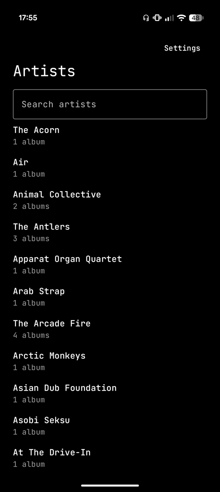
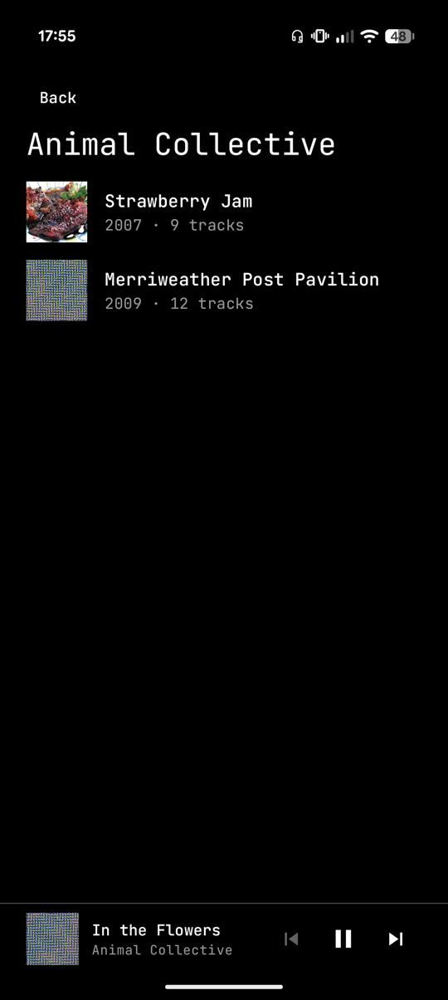
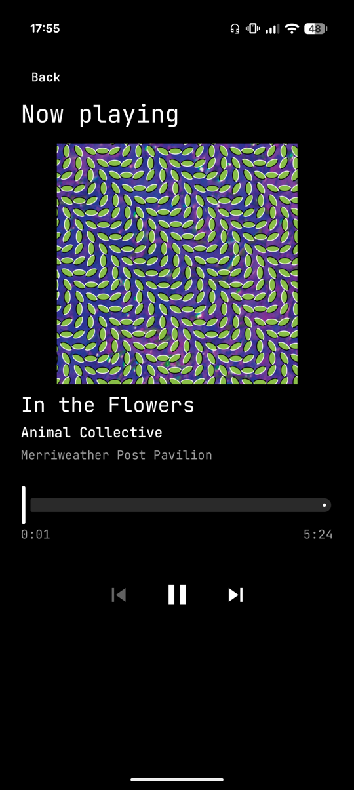

# Athena Music

A minimalist Android music player that streams from your own Navidrome (Subsonic API) server. Browse artists, albums and tracks; play with play/pause, previous/next and a seek bar; lock-screen and headset controls via Media3. Monochrome look shared with [Athena Launcher](https://github.com/Larmen/athena-launcher) and [Athena Podcasts](https://github.com/Larmen/athena-podcasts). Android 16 and 17 only. MIT licensed.

Development is spec-driven with GitHub Spec Kit: start with [CLAUDE.md](CLAUDE.md) and `specs/001-music-core/`.

## Screenshots

<table>
<tr>
<td align="center"><br>Artists</td>
<td align="center"><br>Albums</td>
<td align="center"><br>Now playing</td>
</tr>
</table>

## Status
Spec, plan and tasks written; app built (sign-in, library browsing, streaming playback, settings, licences) with unit tests for the server client. Verified against the real server on the API 37 emulator (sign-in, browse, play, next, pause, seek); lock screen, headset and Bluetooth still to check – see `docs/manual-qa.md`.

## Build and install
```bash
export JAVA_HOME="/Applications/Android Studio.app/Contents/jbr/Contents/Home"
echo "sdk.dir=$HOME/Library/Android/sdk" > local.properties   # gitignored
./gradlew assembleDebug testDebugUnitTest lintDebug
adb install -r app/build/outputs/apk/debug/app-debug.apk
```
Debug builds share one signing key on this Mac, which lets the launcher and this app share appearance settings. For release, sign all Athena apps with one keystore.
